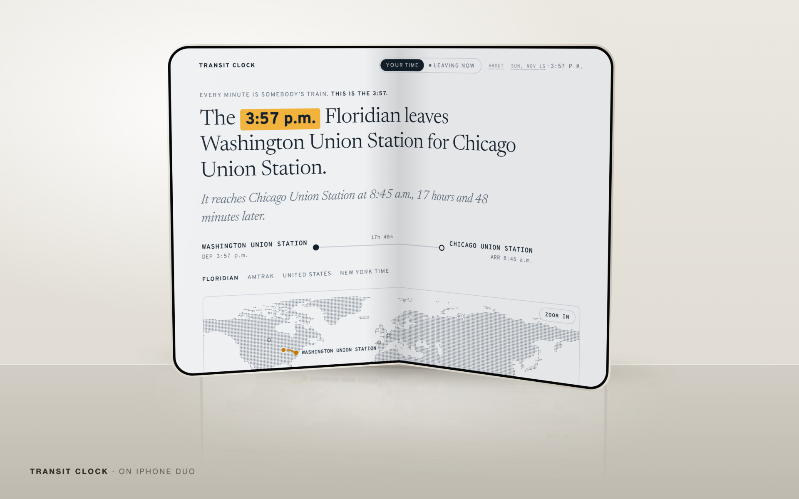
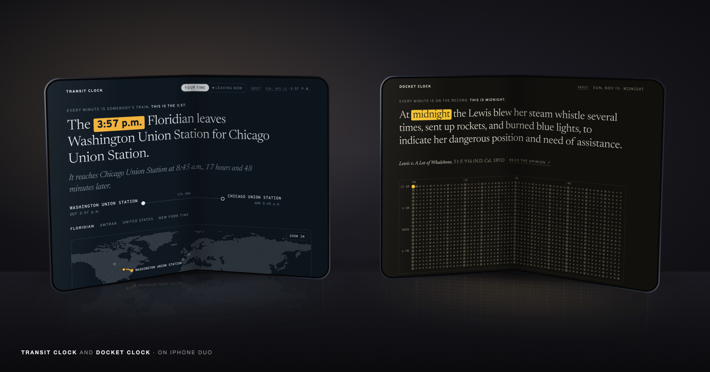

# Transit Clock

A clock made of timetables. Every minute it shows a real train, ferry or bus
that is timetabled to leave at exactly that minute, somewhere in the world.

> The **3:57 p.m.** Floridian leaves Washington Union Station for Chicago
> Union Station.
>
> *It reaches Chicago Union Station at 8:45 a.m., 17 hours and 48 minutes
> later.*

**Live:** https://zula-root.github.io/Transit-Clock/



*A rendering of the clock on an iPhone Duo, not a photograph.*

Every minute is somebody's train. There are 9,989 departures in the data, and
all 1,440 minutes of the day have at least six.

## Where the idea comes from

The [literary clock](https://literature-clock.jenevoldsen.com/) tells the time
with sentences from novels: at 4:12 you read a line of fiction that happens to
mention 4:12. It began in 2011, when the Guardian asked its readers to send in
quotations. Jaap Meijers put the list on an old Kindle, and Johannes
Enevoldsen made the web version.

A timetable turns out to be full of sentences too. "The 4:12" is already how
people name a train they mean to catch. This clock takes that literally.

## How to read it

- **The line above the sentence** says what the clock is and which train this
  is: "Every minute is somebody's train. This is the 4:12."
- **The sentence** is a real departure, with the time on a departure-board
  chip. Under it is the route as a board would show it, and a map that flies
  to the line.
- **Your time** matches the minute on your clock to a station clock anywhere
  in the world. **Leaving now** shows what is pulling out at this instant,
  each on its own local clock.
- **Another 4:12** steps through the other departures that share the minute.
  The space bar and the arrow keys do the same.
- The date in the corner opens a card with the day's first and last
  departures.

Each minute opens on a departure a stranger can picture: a train with a name
or a long-distance brand, or a ferry, that starts or ends in a well-known
city. The others are a tap away.

## Put it on a phone, a tablet or a foldable

The page is built to be left running on a stand.

**iPhone or iPad**

1. Open the clock in Safari.
2. Tap Share, then **Add to Home Screen**.
3. Open it from the new icon. It runs full screen, without Safari's bars.
4. Stand the device up and plug it in.

The page asks the device to keep the screen on while it is open. If yours
still dims, set Settings, Display & Brightness, Auto-Lock to Never while it is
on the stand.

**A foldable, such as iPhone Duo**

Follow the same steps, then open the phone part-way and stand it on the desk.

**Android**

Open the clock in Chrome, then choose **Add to Home screen** or **Install app**
from the menu.

A few options go on the end of the address:

| Add this | What it does |
| --- | --- |
| `?theme=dark` or `?theme=light` | Holds one theme whatever the device is set to. Dark suits a bedside. |
| `?at=16:12` | Holds the clock at one minute, to share a single train. |
| `#live` | Opens in Leaving now. |
| `#widget` | A square card the size of a Home Screen widget. |

## Run it locally

The page loads its data with `fetch`, so serve the folder instead of opening
the file:

```
python3 -m http.server
```

Then open http://localhost:8000.

## Files

```
index.html            the clock: markup, styles and script in one file
data/00.json … 23     one file per hour: the departures for each minute
data/days.json        the first, last and longest trips for each date
data/land.json        coastlines for the dot-matrix map
manifest.webmanifest  lets a phone install it to the Home Screen
icon.svg, icon-*.png  the icon
```

There is no build step and nothing to install.

## Credits

- The idea: the Guardian's readers, Jaap Meijers and Johannes Enevoldsen.
- Times: the operators' published timetables. Each departure names its
  operator on the page.
- Type: Newsreader, Overpass and Overpass Mono.
- A sibling: the [Docket Clock](https://github.com/zula-root/Docket-Clock),
  which tells the time with sentences from court opinions.


